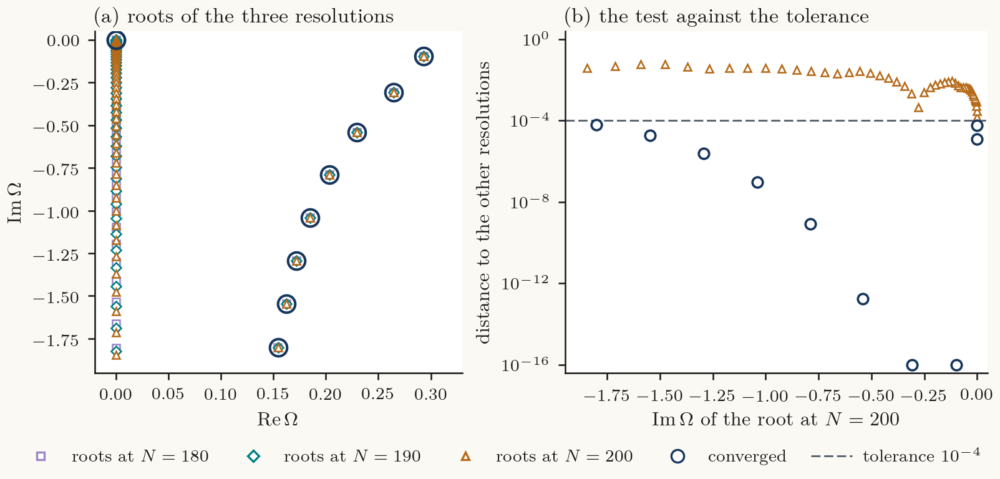

<!-- QNM Analyser
     Author: Dr. Denys Dutykh
             Khalifa University of Science and Technology, Abu Dhabi, UAE
             https://www.denys-dutykh.com/ -->

# qnm-analyser: the quasinormal modes that agree across numerical resolutions



QNM Analyser applied to the example files of `examples/schwarzschild-l1/`: every finite root Ω = Mω of a spectral discretisation of a massless scalar field with ℓ = 1 around a Schwarzschild black hole of mass M, at the resolutions N = 180, 190 and 200, with the default tolerance 10⁻⁴. Panel (a) shows the roots of the three resolutions in a window of the complex plane: the column on the imaginary axis moves from one resolution to the next, while the eight roots circled in navy, the Schwarzschild modes 0.292936 − 0.097660i, 0.264449 − 0.306257i and their overtones down to 0.154463 − 1.800464i, are found at every resolution. Panel (b) shows the test that decides it: for each root at N = 200, its distance to the nearest root of each lower resolution (the larger of the two), against the tolerance. The genuine modes pass, their distances growing from exact agreement in double precision (drawn on the lower edge) for the two lowest to 6.5 × 10⁻⁵ for the eighth, while the roots on the imaginary axis fail, most of them by more than a factor of ten; only where they crowd together near Ω = 0 do two of them pass. The figure is drawn by `docs/figures/plot_readme_figure.py` with the tool's own reading, matching and classifying functions.

QNM Analyser is an interactive web application, written with Dash, for telling genuine quasinormal modes from numerical noise in eigenvalues computed at several resolutions: a genuine mode appears at every resolution, a spurious root does not. It matches the roots of the highest resolution with those of the lower ones, keeps those that agree within a tolerance, classifies them, and draws them in the complex plane. The online version is not available at present; the tool runs on a local computer, as described below.

## What it does

| Feature | What it does |
| --- | --- |
| File upload | eigenvalue files are dropped into slots (3 by default, up to 6), each holding two columns, the real and imaginary parts of the eigenfrequencies |
| Resolution from the file name | the resolution `N` is read from the file name (`eigs_90.dat` gives `N = 90`, and `eigs_2024_90.dat` also gives `N = 90`, since the last group of digits is used); if the name has no digits, the tool asks for `N` rather than guessing |
| Upload messages | unreadable or invalid files produce a visible message instead of failing silently |
| Convergence analysis | the modes present at every uploaded resolution within a tolerance chosen by the user are found by nearest-neighbour matching with KD-trees |
| Classification | the converged modes are sorted into general, purely imaginary and purely real |
| Interactive plot | a Plotly scatter plot in the complex plane with zoom, pan, hover readout, a palette safe for colour-blind readers (Wong 2011) and axis labels typeset by MathJax |
| Click to inspect | a click on a converged mode shows its value and its spread across resolutions |
| Themes | dark and light, the choice remembered in the browser's local storage |
| Reset | one click clears the datasets, restores the default controls and resets the view |
| Symmetry | only Re(ω) ⩾ 0 is shown, since the spectrum is symmetric about the imaginary axis |
| Export | the current view as a high-resolution PNG or a PDF, a text report of the converged modes (with the gaps Δ Im(ω) between consecutive purely imaginary modes), or the converged eigenvalues as a `.dat` file |

No uploaded data is stored on the server: all the state of a session lives in the browser and is discarded when the tab is closed.

## Data format

Each file holds two columns separated by white space:

```text
Re(omega_1)  Im(omega_1)
Re(omega_2)  Im(omega_2)
...
```

Lines beginning with `#` and blank lines are ignored, and rows that are `NaN` or `Inf` are skipped. A single file may carry at most 100 000 eigenvalues.

## Convergence algorithm

The datasets are sorted by resolution, and the highest resolution becomes the reference set. For each eigenvalue of the reference set, the KD-tree of every lower resolution is queried, and the eigenvalue is converged if its nearest neighbour lies within the tolerance for every lower resolution. The converged modes are then classified, with `tol` the chosen tolerance:

```text
general           |Re(ω)| ⩾ tol   and   |Im(ω)| ⩾ tol
purely imaginary  |Re(ω)| < tol   and   |Im(ω)| ⩾ tol
purely real       |Im(ω)| < tol
```

The tolerance is set in the interface in units of 10⁻⁴.

## Running locally

```bash
python3 -m venv venv
source venv/bin/activate
pip install -r requirements.txt
python app.py
```

Then open the address `http://127.0.0.1:8050` in a browser. To try the tool, upload the three files of `examples/schwarzschild-l1/`, the spectra of the figure above, computed with the codes of the repository massive-scalar (folder `data/mu_0_0_L_1/raw/`):

https://github.com/dutykh/massive-scalar

To enable the Werkzeug debugger while developing, set `DASH_DEBUG=1`; leave it unset otherwise, since the debugger exposes an interactive console.

## Tests

```bash
pip install -r requirements.txt -r requirements-dev.txt
pytest
```

The suite covers the upload parser, the convergence and classification routines, the shared figure builder (including the rejection of malformed zoom ranges sent by the browser), the state machine of the slots, and the signature check of the webhook. The pinned dependencies can be checked for known vulnerabilities with

```bash
pip-audit -r requirements.txt
```

## Deployment on a server

The repository also holds what a deployment on a server needs: the process definitions for PM2, the Gunicorn settings, the Traefik router and middlewares, a deploy script, and a webhook receiver that redeploys the application when GitHub reports a push. The guide, with the operations commands and a troubleshooting runbook, is [DEPLOYMENT.md](DEPLOYMENT.md).

## Project structure

```text
qnm-analyser/
├── app.py                          # Dash application: layout, callbacks, analysis
├── webhook.py                      # GitHub deploy webhook receiver
├── gunicorn_conf.py                # Gunicorn settings (env-overridable)
├── ecosystem.config.js             # PM2 process definitions for app and webhook
├── start.sh                        # PM2 entry point for the application
├── webhook_start.sh                # PM2 entry point for the webhook
├── deploy.sh                       # Pull, install, restart, health-check
├── requirements.txt                # Runtime dependencies (exact pins)
├── requirements-dev.txt            # Test and audit tooling
├── pyproject.toml                  # pytest and ruff configuration
├── .env.example                    # Environment template
├── package.json                    # Version stamp shown in PM2 status
├── assets/
│   └── style.css                   # Light and dark theme styles
├── deploy/
│   ├── install-traefik.sh          # Installation of the Traefik configuration
│   └── traefik-qnm-analyser.yml    # Traefik routers, service, middlewares
├── docs/figures/                   # The figure of this page and the script that draws it
├── examples/schwarzschild-l1/      # Three example spectra, N = 180, 190, 200
├── tests/
│   ├── test_analysis.py            # Parser, convergence, figure builder
│   ├── test_slot_actions.py        # Upload/reset state machine
│   └── test_webhook_security.py    # Signature verification and deploy gating
├── DEPLOYMENT.md                   # Deployment and operations guide
├── README.md                       # This file
└── LICENSE                         # LGPL v2.1
```

## Dependencies

| Package | Purpose |
| --- | --- |
| dash | web framework and interactive interface |
| plotly | scientific visualisation |
| numpy | numerical computation |
| scipy | KD-trees for the convergence matching |
| kaleido | export of PNG and PDF figures on the server |
| gunicorn | WSGI server for production |
| flask | web framework behind the webhook |

The versions are pinned exactly in `requirements.txt`. The application loads no third-party script: MathJax is served from the application's own origin, so that the page satisfies a `script-src 'self'` content-security policy. The figure of this page needs only NumPy, SciPy and Matplotlib, and LaTeX for its labels when a TeX installation is present.

## Security

Uploads are parsed as plain text only: nothing is deserialised, evaluated or written to disk. Their size is capped at 10 MB by the application and again at the reverse proxy, and at 100 000 eigenvalues per file. Image export renders a figure rebuilt on the server from the uploaded numbers; figure JSON sent by the browser is never handed to the rendering engine. The deploy webhook verifies an HMAC-SHA256 signature in constant time and fails closed when no secret is configured.

Please report security issues privately, by e-mail to the contact address given on the About page of the author's website, rather than in a public issue:

https://www.denys-dutykh.com/about

## How to cite

If you use QNM Analyser in your work, please cite it as software:

```text
D. Dutykh, qnm-analyser: the quasinormal modes that agree across numerical resolutions,
software, version 1.0.0 (2026).
```

https://github.com/dutykh/qnm-analyser

The button "Cite this repository" in the right-hand column of this page gives the same reference, read from `CITATION.cff`.

## Licence

GNU Lesser General Public License, version 2.1 (see [LICENSE](LICENSE)).

## Author

Denys Dutykh, Mathematics Department, Khalifa University of Science and Technology, Abu Dhabi, United Arab Emirates.

https://www.denys-dutykh.com/
